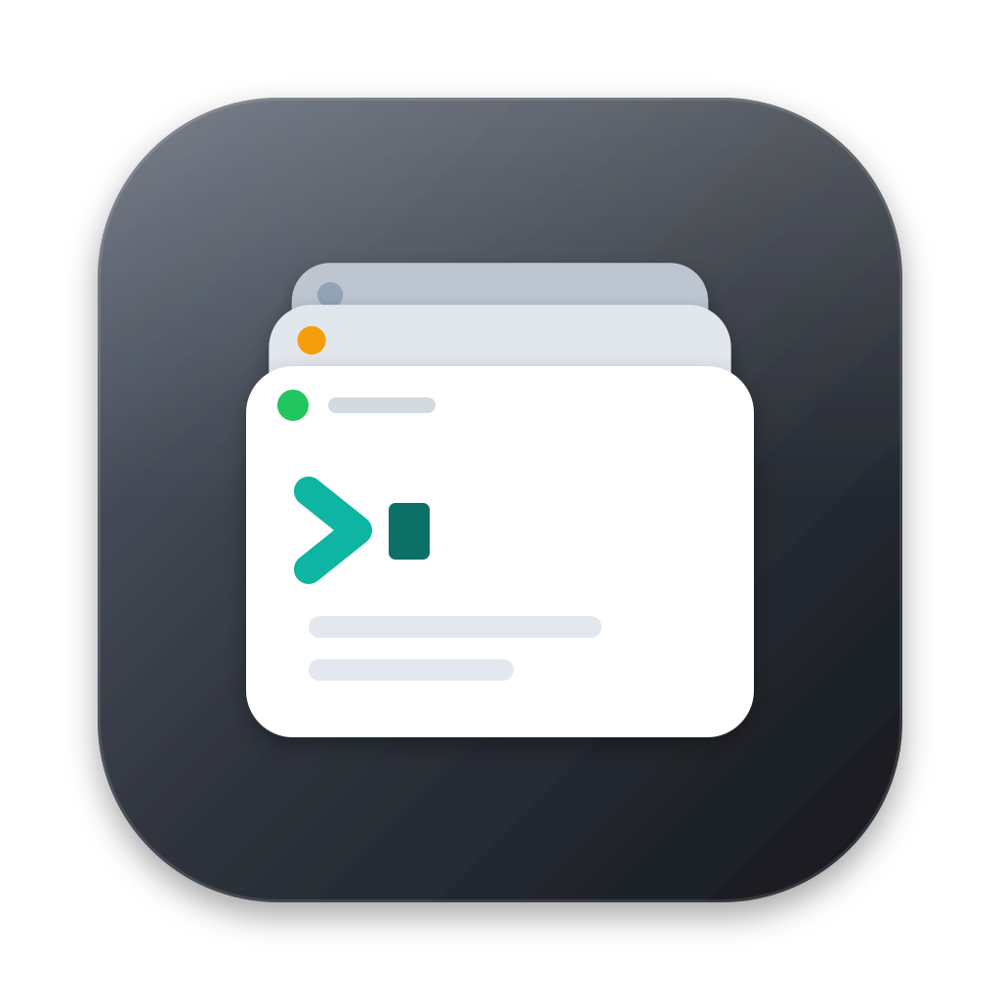

<p align="center"></p>

<h1 align="center">Muxbar</h1>

<p align="center"><b>Mission control for your AI coding agents.</b><br>
Run many Claude Code, Codex, Gemini CLI or other agent sessions side by side, on your Mac and
on remote machines, and see at a glance which ones are working, finished or waiting for you.</p>

<p align="center">
<a href="#install">Install</a> ·
<a href="#a-quick-tour">Tour</a> ·
<a href="#features">Features</a> ·
<a href="#faq">FAQ</a> ·
<a href="CONTRIBUTING.md">Contribute</a>
</p>

---

## Why Muxbar?

Coding agents are great at long tasks, so you end up running several at once: one refactoring
the API, one fixing a flaky test, one writing docs. Some run on your laptop, some on a beefy
remote box. Soon you have a dozen terminal tabs and keep flipping through them to answer
*"Is it done yet? Is it stuck asking me something?"* Then the VPN drops or the laptop sleeps,
and the remote sessions are gone.

Muxbar fixes that:

- **One window for every session, on every machine.** A sidebar lists all your agent sessions,
  grouped by host and project. Click one and its live terminal appears on the right.
- **You know who needs you.** Each session shows whether it's **working**, **waiting for you**
  (a permission prompt or question) or **idle**. Sessions that finish or need input go into an
  **Inbox**, with a notification and a Dock badge.
- **Sessions never die by accident.** Every session runs in [tmux](https://github.com/tmux/tmux).
  Close the laptop, lose Wi-Fi, quit Muxbar: the agent keeps working, and Muxbar reconnects when
  you're back.
- **Works with any agent.** Claude Code and Codex get the deepest support; Gemini CLI, Aider,
  Grok, opencode, Goose, Amp or your own CLI work too.
- **Nothing in the middle.** Muxbar doesn't wrap your agent, call a model API or type for you.
  Each agent runs unmodified in a real terminal; Muxbar just watches and organizes. It needs no
  account, has no telemetry and is free and open source (MIT).

```
┌ Muxbar ──────────────────────┬─────────────────────────────────────────────┐
│ Inbox                        │ ● api-refactor · devbox · ~/src/api         │
│  ● docs-site      Waiting    │─────────────────────────────────────────────│
│  ● perf-fix       Finished   │ ✻ Refactoring handlers… (2m · thinking)     │
│ This Mac          12/36 GB   │                                             │
│  ● docs-site      Waiting    │                                             │
│ devbox            25/64 GB   │                                             │
│  ▾ API                       │ ─────────────────────────────────────────── │
│   ▸● api-refactor Working    │ ❯ _                                         │
│    ● perf-fix     Idle       │                                             │
│ + New Session                │  [api-refactor] 0:claude*                   │
└──────────────────────────────┴─────────────────────────────────────────────┘
```

## Install

You need a Mac with **macOS 14.5 or later**. That's all: no Xcode, no Apple developer account.

```bash
git clone https://github.com/ganeshpanaskar/muxbar.git
cd muxbar && ./install.sh
```

The installer builds Muxbar on your Mac (about a minute the first time), installs tmux if it's
missing (through [Homebrew](https://brew.sh) or MacPorts), puts the app in
`~/Applications/Muxbar.app` and starts it. Because the app is built locally, macOS doesn't
block it.

If `git` isn't installed yet, macOS offers to install the Command Line Tools the first time you
run it (or run `xcode-select --install`).

### First launch

A **Set up Muxbar** window asks two things. Both can be skipped and changed later in Settings.

1. **Where to keep session folders on this Mac.** Default `~/muxbar-sessions`. A session you
   create without picking a folder gets its own folder under it.
2. **Your remote machines, if any.** Type `devbox.example.com`, `user@host`, or pick an alias
   from `~/.ssh/config`. Muxbar checks each one right away and shows "Connected · Linux ·
   tmux 3.4", or exactly what's wrong (bad key, unknown host key, no tmux). Remote machines need
   only `ssh` access and tmux 2.6 or later (`sudo apt install tmux` / `sudo dnf install tmux`).

### Updates

Muxbar keeps itself up to date from [GitHub releases](https://github.com/ganeshpanaskar/muxbar/releases).
Minor and patch releases install themselves (your sessions keep running); a new major version
asks first and shows its release notes. If you've changed the source in your checkout, Muxbar
never touches it and just tells you an update is out. You can turn this off, or click **Check
now**, in Settings → General. To update by hand: `git pull && ./install.sh`.

**Uninstall:** `./install.sh --uninstall`. It asks before deleting your settings and never kills
running sessions.

## A quick tour

1. Click **+ New Session**. Pick a machine, a folder and a name, and what to start: **Claude**
   (the default), **Codex**, a plain **Shell**, or **Other** (any command, like `gemini`).
2. The agent starts in the pane on the right. It's a full terminal: type to it as usual.
3. Start a second and a third session. Switching between them in the sidebar is instant.
4. Go do something else. When an agent finishes or asks for permission, you get a notification
   and the session lands in the **Inbox**. Press **⌘J** to jump to the next one that needs you.
5. Want to watch several at once? **⌘-click** sessions to show them side by side in a **grid**.
6. Close the lid. Tomorrow, open Muxbar: everything is where you left it, and the agents that were
   still working have finished.

## Features

### Status at a glance

Every session has a colored dot:

| Dot | Meaning |
|---|---|
| 🔵 blue | Working |
| 🟠 orange | Waiting for you: a permission prompt, a question or a choice |
| 🟢 green | Idle: finished, ready for the next prompt |
| ⚪ grey | No agent running (a plain shell) |
| faint | Unknown: Muxbar isn't sure, so it doesn't guess |

The menu-bar icon animates while any session is waiting for you, and its menu lists all sessions
for quick switching.

By default Muxbar reads status from the agent's screen. For **Claude Code and Codex** you can turn
on **exact status** in Settings → Exact status (agent hooks): Muxbar installs a tiny hook that
tells it exactly when the agent starts, stops and asks something. [Details below](#exact-status-agent-hooks).

### Works with any agent

| Agent | Status | Exact status (hooks) | History search, resume, sleep |
|---|---|---|---|
| Claude Code (`claude`) | ✅ | ✅ | ✅ |
| OpenAI Codex CLI (`codex`) | ✅ | ✅ | ✅ |
| Gemini CLI, Grok, Aider, opencode, Goose, Amp, Qwen, … | ✅ generic rules | — | — |
| Your own CLI (New Session → Other) | ✅ generic rules | — | — |

Whatever you choose is remembered for next time (Settings → New sessions). Adding deeper support
for another agent is a great first contribution: see [CONTRIBUTING.md](CONTRIBUTING.md).

### Local and remote sessions that survive anything

- Sessions on your Mac and on any machine you can `ssh` to live in one sidebar, grouped by host.
- Everything runs in tmux, so a VPN drop, sleep, an expired SSH login or quitting Muxbar never
  kills an agent. The pane shows **Disconnected — Reconnect**, and Muxbar reconnects on its own
  once it can.
- If a machine restarts, its sessions show as **ended**. Click **Resume Session** and Muxbar
  recreates it with the same name, folder and group, and continues the agent's conversation.
- tmux sessions you started yourself (`tmux new -s foo`) show up under **Others**; click to attach.

### Inbox and notifications

- When an agent finishes a turn or starts waiting while you're looking elsewhere, its session
  becomes **unread** and goes into the **Inbox** at the top of the sidebar: ones needing input
  first, then finished ones, each with the start of the agent's reply.
- Looking at a session for a moment marks it read; right-click → **Mark as Read / Unread**.
- **⌘J** jumps to the next session in the Inbox.
- Notifications when a turn finishes, and a Dock badge (Settings → Notifications).

### Quick switcher and grid

- **⌘K** opens a switcher, even while you're typing in a terminal. It starts with **Needs you**,
  **Finished** and **Recent**; type a few letters to match a session's name, group, host, folder
  or first prompt.
- The **grid** shows 2–6 live sessions side by side: ⌘-click in the sidebar, right-click →
  **Add to Grid**, right-click a group → **Show Group in Grid**, or ⌥⏎ in the switcher. Keys go to
  the focused tile only; **⌃⌘ + arrows** move focus, **⌘⏎** zooms the focused tile and back.

### Projects, groups and folders

- **Groups** organize a host's sessions (e.g. per project). Drag sessions onto a group, or
  right-click → **Move to Group**.
- Leave **Folder** empty in New Session and Muxbar creates `<root>/<group>/<session>` for you. The
  folder follows the session: rename the session or move it to another group and the folder is
  renamed or moved too. Muxbar only moves folders it created, never overwrites anything and never
  deletes a folder.

### Pick up any conversation

- **⌘⇧H Search History** searches everything you and your agents said, across Claude Code and
  Codex history, on this Mac or any remote machine. Open a result to see the last turns, folder,
  git branch and model, then **Resume in New Session** or copy the resume command.
- **Continue Claude Session…** lists recent Claude conversations on a host, including ones you
  started in a plain terminal, and continues one in a new Muxbar session.

### Memory watch and sleeping agents

- Each host shows its memory use (e.g. "25/64 GB"), orange from 80% and red from 90%. Click it to
  see which sessions and processes are biggest, and stop one if needed.
- Muxbar warns you when a machine crosses the red line, or when memory is dropping fast enough to
  run out within about 5 minutes.
- **Sleep** an idle Claude Code or Codex agent to free its memory: the agent exits, the session
  stays, and **Wake** resumes the same conversation. Muxbar never sleeps an agent that's working,
  waiting, has unsent text in its prompt, has a background job running, or is marked **Never
  Sleep**. Optional **Auto-sleep** (off by default) sleeps agents idle for 30 minutes.

### Port forwarding

Your agent started a dev server on the remote machine? Each remote host has a **Ports** row listing
servers your processes are listening on, with the session that started them (e.g. "8080 · python3
· web-app"). **Forward** makes it available at `localhost` on your Mac and **Open** opens it in
your browser. Forwards listen on your Mac only and come back by themselves after a reconnect.

### Drop files and screenshots into a session

Drag files or images onto a pane, or press **⌘⇧V** to paste a screenshot from the clipboard. The
file's path is typed into the session (nothing is sent until you press Return); Claude Code turns
an image path into an attached image. For remote sessions Muxbar copies the file over first, to
`~/.muxbar/drops/` on that machine, and deletes those copies after 7 days.

### A good terminal

- The built-in terminal needs no setup. If you prefer, Settings → "Open sessions in" switches to
  Terminal.app or iTerm2 windows instead.
- Scroll with the trackpad, including inside full-screen apps like Claude Code, `less` and `vim`.
- Selecting text copies it. Click a link to open it, even when it wraps onto the next line.

## Keyboard shortcuts

| Keys | |
|---|---|
| ⌘K | Quick switcher |
| ⌘J | Next session that needs you (waiting, then finished) |
| ⌘⇧H | Search conversation history |
| ⌘⇧V | Paste the clipboard image into the session |
| ⌘-click | Add a session to the grid, or take it out |
| ⌘⏎ | Grid ↔ the focused tile alone |
| ⌃⌘ ← → ↑ ↓ | Focus another grid tile |
| ⌘, | Settings |

## Exact status (agent hooks)

Reading status from the screen works for any agent but is a heuristic. Claude Code and Codex can
report it themselves. Turn this on per machine and agent in **Settings → Exact status (agent
hooks)**:

- **Claude Code:** **Install…** copies Muxbar's small status plugin to `~/.muxbar/agent-plugin` on
  that machine and registers it with Claude's own plugin commands. **Remove** undoes exactly that.
  If your organization's policy blocks plugins, the row says **Blocked** and nothing is changed.
- **Codex:** **Install…** adds Muxbar's handlers to `~/.codex/hooks.json` (or `$CODEX_HOME`). Your
  own handlers stay, a backup is kept, and **Remove** takes out only Muxbar's. Codex asks you to
  approve new hooks once: run `/hooks` in Codex.
- The hook only writes one small status file per terminal pane under `~/.muxbar/state/`. It never
  prints anything, never blocks the agent and always succeeds.
- Restart agents that were already running so they pick up the hooks.

With hooks on, Muxbar also knows each session's conversation id, so Resume and Wake always
continue the right conversation.

## Command line

The app also works from scripts. Commands go to the running app:

```bash
M=~/Applications/Muxbar.app/Contents/MacOS/Muxbar
$M --cli list
$M --cli new --host devbox --name api-refactor --dir ~/src/api --group API
$M --cli focus --host devbox --id api-refactor
$M --cli inbox                                  # waiting, then finished
$M --cli history-search --host devbox --query "flaky test"
$M --cli memory --host devbox                   # biggest sessions and processes
$M --cli ports --host devbox                    # also: forward / unforward --port 8080
$M --cli settings-set --start other --other-command gemini
$M --cli                                        # full list of commands
```

## Privacy and permissions

- **Network:** nothing leaves your Mac except SSH to your own machines and a daily check of
  GitHub's public releases for updates (can be turned off). Muxbar never contacts any AI provider
  and sends no telemetry.
- **SSH:** Muxbar uses your normal `ssh` and `~/.ssh/config` (it never edits it), with one shared
  connection per machine. It never asks for or stores passwords.
- **Your data:** session names, groups and settings are in
  `~/Library/Application Support/Muxbar/state.json` (plain JSON), logs in `~/Library/Logs/Muxbar/`.
  On each machine Muxbar only writes under `~/.muxbar` (status files, dropped files and the Claude
  plugin if you install it).
- **macOS prompts:** with the built-in terminal there are none. If you choose Terminal or iTerm2,
  macOS asks once whether Muxbar may control it. The installer creates a local signing identity
  used only to sign Muxbar, so macOS remembers your answers across updates. If permissions ever
  get stuck, click **Reset permission** in Muxbar's banner or run `./install.sh --reset-permissions`.

## FAQ

**Does Muxbar need an API key or change how my agent works?**
No. It starts your agent's normal CLI in a terminal, exactly as you would. Your agent's login,
settings and billing are untouched.

**Do I need a remote machine?**
No. Muxbar is just as useful with only local sessions.

**What happens to my sessions if Muxbar quits or crashes?**
Nothing. They keep running in tmux, and Muxbar reattaches when it starts again.

**Can I use it without tmux?**
On your Mac, `./install.sh --no-tmux` skips installing it, but local sessions are then plain
windows that end when closed. Remote machines need tmux.

**Is it only for AI agents?**
No. A **Shell** session is a normal terminal; Muxbar is a pleasant way to manage any long-running
tmux sessions. The status features are just most useful for agents.

## Known limitations

- **Without hooks, status is a best guess from the screen.** If an agent changes its look, Muxbar
  may show Unknown until the patterns are updated. Other agents use generic rules only.
- **Terminal.app opens one window per session**, not tabs. Use iTerm2 or the built-in terminal.
- **A port forward stays open up to 10 minutes after quitting Muxbar.**
- **Expired SSH logins behind some proxies** look like a plain "connection closed", so the host
  shows Unreachable rather than an auth error.

## Development

Muxbar is Swift + SwiftUI and builds with the Command Line Tools alone.

```bash
make test      # unit tests
make install   # build, sign with the local identity, install, relaunch
make bundle-test && scripts/test-instance.sh start   # an isolated "Muxbar Test" instance
HOST=local  scripts/e2e.sh                      # end-to-end tests against local tmux
HOST=devbox scripts/e2e.sh                      # …or against any ssh host with tmux
```

The end-to-end tests drive a separate **Muxbar Test** app with its own home, state and tmux
server, so your installed Muxbar and your sessions are never touched.

- `Sources/MuxbarCore`: the logic (host probe, status classifier, agents and hooks, SSH, history,
  sleep, ports, persistence, updates), all unit-tested.
- `Sources/Muxbar`: the app (window and menu bar, terminals, the control socket behind `--cli`,
  the updater).

Contributions are welcome. See [CONTRIBUTING.md](CONTRIBUTING.md).

## License

[MIT](LICENSE)
